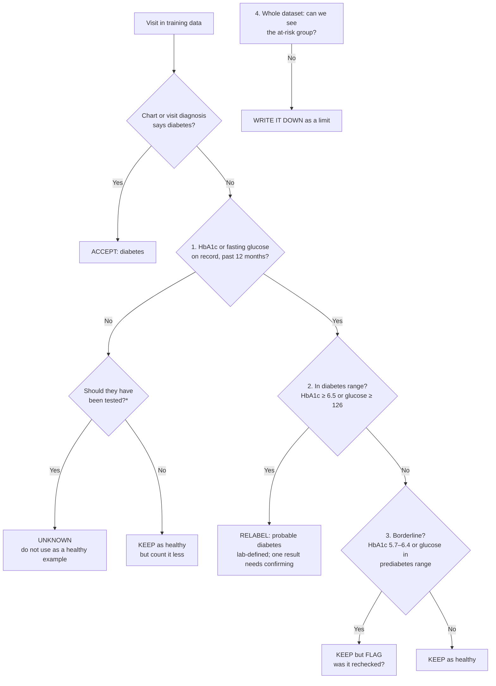

# NAMCS 2018–2019 Data Card: Type 2 Diabetes

**For:** data curators and AI developers building models from the NAMCS 2018–19 public-use files.
**Purpose:** stop a model from learning the missed-diagnosis patterns in this data. It covers when to accept the chart's diagnosis, how to treat missing tests, and what to check before release.
**Evidence base:** a sex-gap audit of NAMCS 2018–19 (with NHANES as an external check), a blind model-training run, and a refit of those models. Sources are given as **[Audit]**, **[Blind]** and **[Refit]**; see *Sources* at the end.
**Small groups:** any number based on a small group (fewer than 30 people, or only just above 30) is marked **(lead)**. Treat it as a reason to look further, not as a finding.

---

## 1. Read this first

1. **A missing diagnosis is not a negative diagnosis.** About 1 in 4 women whose labs are in the diabetes range have no diabetes in the chart.
2. **Define diabetes from lab values as well as the chart.** If HbA1c is ≥ 6.5% or fasting glucose is ≥ 126 mg/dL, label the visit "probable diabetes (lab-defined)".
3. **An untested patient is unknown, not healthy**, if guidelines say they should have been tested.
4. **A missing test is not a normal result.** Keep missing-value flags. Never fill in normal values.
5. **Either test in the diabetes range counts.** A normal result on one test doesn't cancel a high result on the other. A high fasting glucose with a normal HbA1c is still probable diabetes (lab-defined).
6. **Don't let weight act as a gate.** Lean patients with high labs are among the most often missed (small groups; see section 3).
7. **Keep sex as a field and audit by it.** Use the same diagnostic thresholds for women and men.

---

## 2. About the data

| Fact | What it means for a model |
|---|---|
| One row = one **office visit**, not one patient | The same person can appear more than once. You can't follow anyone over time. |
| Survey weight **PATWT** | Use it for national estimates and weighted metrics. Its range is very wide, so check weighted and unweighted results. |
| Lab results (HbA1c `A1CRES`, fasting glucose `FBGRES`) are **only asked of primary-care physicians**, and only cover the **past 12 months** | Lab fields are blank or "not applicable" for most visits. Adults with the lab section filled in: 5,687 of 15,885 visits [Audit]. |
| **No follow-up** | There's no way to see later diagnoses, admissions or delays. |
| 2018 and 2019 pooled | The 2018 and 2019 weights were built with different methods. Halve PATWT when pooling, and add year as a variable. |

---

## 3. Known gaps in this data (the evidence)

| Finding | Women | Men | Group size (W / M) | Source |
|---|---|---|---|---|
| Labs in diabetes range, **no diabetes in chart** | 26% | 14% | 260 / 284 visits | [Audit], adjusted OR 2.38 (95% CI 1.30–4.38) |
| …when **only fasting glucose** was high | 53% | 33% | 100 / 87 | [Audit] |
| …when BMI was **under 25** | 63% | 20% | 33 / 30 **(lead)** | [Audit] |
| …age 35–49 | 62% | 7% | 26 / 28 **(lead)** | [Audit] |
| Adults 35–70 without diabetes: **HbA1c or glucose on record** | 35% | 41% | 1,713 / 921 | [Audit], adjusted OR 0.70 (0.51–0.95) |
| Prediabetes-range labs: diet, exercise or weight advice | 15% | 26% | 313 / 249 | [Audit], OR 0.59 (0.34–1.03), not significant |
| **External check (NHANES 2017–20):** people with diabetes who were never diagnosed | 20% | 13% | 810 / 891 | [Audit], adjusted OR 1.80 (1.11–2.93) |
| **External check (NHANES 2015–16):** undiagnosed diabetes that **fasting glucose missed** | 49% | 26% | 72 / 86 | [Audit] |

**What models trained on this data learned:**
- **Diabetes-recorded model:** sex odds ratio 0.81 (95% CI 0.68–0.98). Shared-fields logistic model, medicine fields removed, 15,885 visits [Refit].
- **Fasting-glucose-only cases:** when only fasting glucose was high, models scored 21–66% of people below 50%, depending on model, dataset and sex. When only HbA1c was high, the figure was 0–15% [Blind].
- **Lean women:** missed more than lean men in NHANES, 24% vs 16% (105 / 146 people). That difference is not statistically significant: +8.3 points, 95% CI −5.0 to +16.9 [Refit].

---

## 4. When to accept the chart's diagnosis

**Text version (for people and AI tools):**

1. If the chart (`DIABTYP0/1/2 = 1`) or a visit diagnosis (ICD E08–E13) says diabetes → **accept: diabetes.**
2. Otherwise, check whether an HbA1c or fasting glucose is on record for the past 12 months (`A1C = 1` or `FBG = 1`).
   - **No lab, and the patient should have been tested*** → label **unknown**. Leave the visit out of the "healthy" class, or give it its own missing-label category.
   - **No lab, and testing was not indicated** → keep as **healthy**, but give it lower weight. Pick a weight (for example 0.5), state it, and report results with and without it.
3. A lab is on record and it's in the diabetes range (HbA1c ≥ 6.5% or fasting glucose ≥ 126 mg/dL) → **relabel: "probable diabetes (lab-defined)".** A single result normally needs a repeat test to confirm, so keep this as a separate label from chart-confirmed diabetes. "Probable diabetes" is a **flag, not a diagnosis**: it means *labs suggest diabetes; needs confirming*. A model trained with this label should flag patients for follow-up testing, not diagnose them.
4. A lab is on record and it's borderline (HbA1c 5.7–6.4%, or fasting glucose in your stated prediabetes range) → **keep, but flag** it "borderline – recheck status unknown".
5. A lab is on record and it's normal → **keep as healthy.**
6. **Whole dataset:** if an at-risk group can't be seen (too few visits, or not recorded), **write it down as a limit** in your model card. Don't assume the model works for that group.

**For a yes/no diabetes model:** never count probable diabetes (lab-defined) as "no". By default, count chart diabetes and probable diabetes as "yes", since the model's job is to flag people for confirmation. You may instead leave probable cases out of training, as long as you say so. Report a chart-only version as a sensitivity check, and leave "unknown" visits out of the "no" class. When the model is used, a high score with no chart diagnosis should be shown as a flag ("labs suggest diabetes; confirm"), not a diagnosis.

**\*"Should have been tested" (screening indications; the same rules for women and men):**
- Age 35–70 with BMI ≥ 25 (US guideline), or BMI ≥ 23 for Asian adults.
- Age 40 or over (Canadian guideline).
- Past gestational diabetes.
- PCOS.
- Classic high-blood-sugar symptoms: excessive thirst, frequent urination, unexplained weight loss, blurred vision, recurrent genital yeast infections.

---

## 5. Rules for features

- **A missing test is not a normal result.** Keep a flag for "no HbA1c on record" and "no glucose on record". Never fill missing labs with normal values.
- **Neither test rules diabetes out on its own.** In NHANES 2015–16, fasting glucose missed 49% of women's vs 26% of men's undiagnosed diabetes, and HbA1c missed 74% vs 80% (72 / 86 people) [Audit]. Count a result in range on either test. The glucose tolerance test is **not recorded** in NAMCS.
- **Don't let weight act as a gate.** Lean patients with high labs are among the most often missed (small groups; see section 3). Don't build rules that require overweight before diabetes is considered.
- **Keep sex as a field, for auditing.** Dropping it does not remove bias, because other fields (visit reason, specialty, medicines) act as proxies. You need it to measure gaps.
- **State your prediabetes cut-off.** Fasting glucose 100–125 mg/dL (ADA/US) or 110–125 (WHO/Canada). The choice changes who is flagged: in NHANES, 48% of women vs 64% of men were flagged at ≥ 100, and 15% vs 22% at ≥ 110 (1,605 / 1,454 people) [Audit]. HbA1c 5.7–6.4% flagged 26% vs 24%.
- **Same thresholds for everyone.** Don't invent sex-specific diagnostic cut-offs.

### Leakage: fields that give the answer away

| Predicting… | Leave out |
|---|---|
| Diabetes (recorded or lab-defined) | Diabetes medicines, `DIABTYP0/1/2`, diabetes ICD codes, diabetes reason-for-visit codes |
| Whether a diabetes test was ordered | HbA1c and glucose values (a value only exists when a test is on record) |
| Diabetes prescriptions | The medication list it was derived from |

### Coding traps

| Trap | Correct handling |
|---|---|
| **SGLT2 drugs** | Multum class **458**. The codebook's category table is shifted by one row. Class **442** holds TNF blockers (adalimumab, infliximab, etanercept) [Blind]. |
| Other diabetes drug classes | 213 sulfonylureas (glipizide, glimepiride, glyburide), **214 metformin** (drug ID d03807 only), 215 insulin (glargine, regular, aspart, detemir, lispro), 371 DPP-4 inhibitors (sitagliptin, linagliptin, saxagliptin, alogliptin), 373 GLP-1 drugs (liraglutide, exenatide, semaglutide), 458 SGLT2 (canagliflozin, dapagliflozin, empagliflozin), 173 statins (atorvastatin, simvastatin, rosuvastatin, pravastatin, lovastatin). Checked against the drug names in the data, not the codebook table [Drug check]. |
| Combination pills | Class **314** (for example sitagliptin–metformin). Decide whether to count them, and state the choice. |
| ICD codes | Stored at **4 characters**. Prediabetes R73.03 is folded into R73.0 with other abnormal-glucose codes. |
| `PASTVIS = -7` | **New patient** (not applicable), not "−7 visits". |
| Asian patients | Only identifiable from **unimputed race, `RACEUN = 3`**. The imputed race/ethnicity variable folds Asian patients into "other". |
| Lab fields | `A1C` / `FBG`: 1 = result on record, 2 = none, −7 = not collected (non-primary-care visit), −9 = blank. These codings were inferred from the data; the 2019 codebook PDF is offline. |
| Sex coding | NAMCS `SEX`: 1 = female, 2 = male. NHANES `RIAGENDR` is the reverse (1 = male). |

---

## 6. Expected differences that are not bias

Don't "fix" these:
- **Sex-specific care:** pregnancy tests, pelvic ultrasound, urinalysis for pelvic complaints, D-dimer for clot risk. In the ED companion survey (NHAMCS), D-dimer for chest pain was ordered more for women (adjusted OR 2.56, 520 / 428 visits), which is likely appropriate [Audit].
- **Real prevalence differences:** in NHANES, men have diabetes at lower BMI than women. At BMI under 25, 7.5% of men vs 3.7% of women have it (921 / 1,058 people) [Audit]. Don't equalise prevalence.
- **Pregnancy and gestational diabetes visits** are female-only by nature.

The test for bias is whether **similar patients with similar lab values** are treated differently, not whether overall rates differ.

---

## 7. Checks before release

- [ ] **Miss rate by sex** among lab-defined diabetes: the share predicted negative, women vs men, with 95% CIs.
- [ ] The same, split by **BMI under 25 vs 25+**.
- [ ] **Fasting-glucose-only vs HbA1c-only cases**, limited to people with **both** tests. (Most "glucose-only" cases are people with no HbA1c done, not two tests that disagree.)
- [ ] **Sex odds ratio** from the model, with a 95% CI (bootstrap over physicians or survey PSUs).
- [ ] **External check** against a fully tested population, such as NHANES, using its fasting-subsample weight for glucose groups.
- [ ] Report **raw and adjusted** numbers, and **weighted and unweighted**. Large PATWT values can swing small groups.
- [ ] **Flag every group under 30** as a lead.
- [ ] Check **leakage** (section 5) and **coding traps**: confirm drug classes against drug names.
- [ ] Record which **label rule** you used (chart only, or chart + lab-defined) and your **prediabetes cut-off**.

---

## 8. What this dataset cannot show

| Can't show | Why |
|---|---|
| Diagnostic delay, return visits, later diagnosis | Single visits, no follow-up |
| Screening in the year after pregnancy | No follow-up; only 12 gestational-diabetes visits [Audit] |
| PCOS-related diabetes risk | Only 7 PCOS visits [Audit] |
| Recurrent infections | Each visit is seen on its own |
| South Asian vs East Asian differences | Only one Asian race code (`RACEUN = 3`) |
| Gender | Binary sex field only |
| Canadian care patterns | US data |
| Glucose tolerance test results | Not recorded |

---

## Sources

- **[Audit]** `diabetes_audit.py` → `results_diabetes/`. NAMCS 2018–19 adult visits (15,885); NHANES 2017–March 2020 and 2015–16 (OGTT). Adjusted ORs from weighted logistic regression with standard errors clustered on survey PSU. NHAMCS figures from `audit_by_race.py`.
- **[Blind]** `model_predictions.py`, `diabetes_underprediction.py`. Logistic regression and gradient boosting, 5-fold cross-validation grouped by physician.
- **[Refit]** `refit_no_meds.py` → `results_refit/`. Blind-run logistic models refit without diabetes-medicine fields. 1,000-rep bootstrap over physicians (494) and NHANES PSUs; NHANES 2015–16 pooled with 2017–March 2020.
- **[Drug check]** `verify_drug_classes.py` → `results_diabetes/drug_class_check.txt`. Most common drugs under each Multum class code in NAMCS 2018–19 adult visits, named using the NHANES 2015–16 and 2017–20 prescription files.
