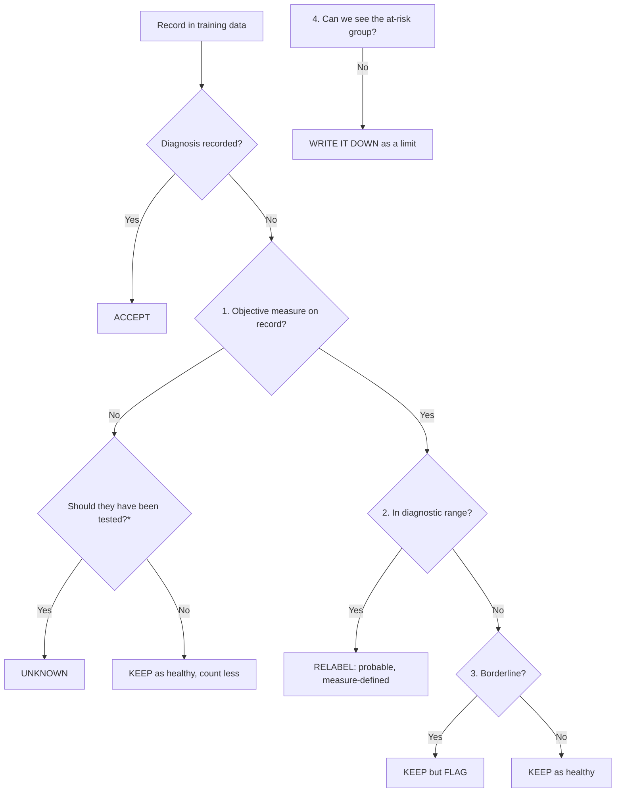

# [Dataset name and years] Data Card: [Condition]

> **How to use this template**
> 1. Copy this file and rename it `[dataset]_[condition]_datacard.md`.
> 2. Replace every [bracketed] item.
> 3. Delete the instruction lines (*Needs:* lines, boxes like this one) when you're done.
>
> For a filled-in example, see `NAMCS_2018_2019_diabetes_datacard.md`.

| Field | Value |
|---|---|
| Dataset and version | [name, years, release or file version] |
| Condition | [condition] |
| Author | [name] |
| Date | [YYYY-MM-DD] |
| Template version | v1.0 |

**For:** data curators and AI developers building models from [dataset].
**Purpose:** stop a model from learning missed-diagnosis patterns in this data. It covers when to accept recorded diagnoses, how to treat missing tests, and what to check before release.
**Evidence base:** [list the audits and model runs behind the numbers, with source tags such as [Audit], [Model]].
**Small groups:** mark any number based on fewer than 30 people in a group as **(lead)**.

> Rules for filling this in: every number needs a source and a group size. Use the guideline's thresholds: the same for all sexes unless the guideline itself sets sex-specific ones (e.g. haemoglobin for anaemia). Never invent sex-specific cut-offs. Fix labels for stated reasons; never reweight until a gap disappears. Write in plain language, readable in about 10 minutes.

> **How much work**
>
> | Level | Effort | What you do | Fills |
> |---|---|---|---|
> | **0 – Required** | About an hour, no analysis | Answer the "Needs:" questions from the codebook. Copy the general rules. Add known gaps for the condition from published research. | Sections 1, 2, 4–6 and 8 |
> | **1 – Recommended** | About a day | Map your column names to the standard checks below and run them. | Sections 3 and 7 |
> | **2 – Optional** | Longer | A full audit. | Adds depth to section 3 |

---

## Standard checks
*Needs: the fields listed beside each check. Run only the checks your dataset has fields for.*

| # | Check | Fields it needs |
|---|---|---|
| 1 | Measure in range but no diagnosis, by sex | Diagnosis + objective measure + threshold + sex |
| 2 | Tested among those who should be, by sex | Test-done flag + eligibility rule |
| 3 | Which test was used, and disagreement when more than one was done | Two or more tests for the same condition |
| 4 | Checks 1–3 within subgroups (age, BMI, race); flag groups under 30 | Subgroup fields |
| 5 | After training: the model's miss rate by sex among measure-defined cases | Trained model + measure-defined cases |
| 6 | If follow-up exists: later diagnosis after an untested or dismissed visit, by sex | Linked visits over time |
| 7 | If family history exists: whether it leads to testing equally by sex | Family-history field + test-done flag |

Checks 1 and 3 only apply to conditions defined by a measurement threshold (e.g. diabetes, high blood pressure, anaemia, kidney disease, high cholesterol). For conditions without one, only checks 2, 4 and 6 apply.

**Warning:** don't scan every field for sex differences. That produces chance results and flags appropriate sex-specific care. Run the checks above, for stated reasons.

---

## 1. Read this first
*Needs: findings from sections 3–5 completed first.*

[5–7 rules, one line each. They should cover how to treat missing diagnoses, how to define the condition from objective measures, missing tests, the main biased test or feature, and auditing by sex.]

---

## 2. About the data
*Needs: documentation of the unit of observation, weights and collection rules.*

| Fact | What it means for a model |
|---|---|
| One row = [visit / patient / admission] | [Can people repeat? Can you follow them over time?] |
| Weights: [variable] | [How to use them; how wide their range is] |
| Lab / measurement fields: [variables] | [Who they were collected for, and over what time window] |
| Follow-up: [yes / no; window] | [What can't be seen] |
| Years pooled: [list] | [Weighting or coding changes between years] |

---

## 3. Known gaps in this data (the evidence)
*Needs: objective measures (lab values, vital signs, imaging results) recorded **alongside** diagnoses, plus a sex field. Ideally also an external, fully tested population to compare against.*

| Finding | Women | Men | Group size (W / M) | Source |
|---|---|---|---|---|
| [Objective measure in diagnostic range, but no diagnosis recorded] | | | | |
| [Same, by test type] | | | | |
| [Same, by key subgroup, e.g. BMI or age] | | | | |
| [Testing / screening rate in the eligible group] | | | | |
| [External check: undiagnosed rate in a fully tested population] | | | | |

**What models trained on this data learned:** [sex odds ratio with 95% CI; miss rates by test type and subgroup; source].

---

## 4. When to accept the recorded diagnosis
*Needs: a recorded diagnosis field **and** at least one objective measure with a known diagnostic threshold. Without measures, only steps 1, 2 (unknown vs healthy) and 6 apply.*

**Label rule:** measure-defined cases get their own "probable" label and must never be counted as "no". For yes/no models, count them as "yes" (the default) or leave them out of training, and say which you chose. Report a version using recorded diagnoses only as a sensitivity check, and leave "unknown" records out of the "no" class. "Probable" is a flag for confirmation, not a diagnosis: when the model is used, a high score with no recorded diagnosis should be shown as "measures suggest [condition]; confirm".

**Text version:** [numbered steps naming the exact fields and thresholds for this dataset].

**\*"Should have been tested":** [screening indications from guidelines. Name the guideline and version. Use the same rules for all sexes, except where an indication is specific to one sex, such as past gestational diabetes.]

---

## 5. Rules for features
*Needs: a list of the candidate model features and how each was derived.*

- **Missing tests:** [how missingness is flagged; never fill in normal values].
- **Known gaps for this condition (from published research):** [sex gaps in diagnosis or testing reported in the literature, with citations and no numbers from your own data]. At level 0, a reference library of known sex gaps by condition can fill this slot.
- **Tests with known blind spots:** [which test misses whom, with the evidence].
- **Gating features:** [features such as weight or age that should not gate a diagnosis].
- **Sex field:** keep it for auditing.
- **Cut-offs:** [which thresholds you used, and the alternatives].

### Leakage
*Needs: a map from each outcome to the source fields it was built from.*

| Predicting… | Leave out |
|---|---|
| [Outcome] | [Fields derived from the same source] |

### Coding traps
*Needs: the codebook, checked against the actual data values.*

| Trap | Correct handling |
|---|---|
| [Code or field] | [What it really means; how you verified it] |

---

## 6. Expected differences that are not bias
*Needs: clinical review of sex-specific care and known prevalence differences for this condition.*

[List the differences that should **not** be "fixed", with evidence. Restate the test for bias: similar patients with similar measures treated differently.]

---

## 7. Checks before release
*Needs: a held-out or cross-validated set, objective measures to define true cases, and ideally an external dataset.*

- [ ] Miss rate by sex among measure-defined cases, with 95% CIs
- [ ] The same within key subgroups: [list]
- [ ] Comparison by test type, limited to people who had all tests
- [ ] Sex odds ratio with a 95% CI (cluster bootstrap)
- [ ] External check: [dataset]
- [ ] Raw and adjusted; weighted and unweighted
- [ ] Groups under 30 flagged
- [ ] Leakage and coding traps checked
- [ ] Label rule and cut-offs recorded

---

## 8. What this dataset cannot show
*Needs: nothing; every dataset should complete this section.*

| Can't show | Why |
|---|---|
| [e.g. delay to diagnosis] | [e.g. no follow-up] |

---

## Sources
[Scripts, output files, datasets and years, statistical methods.]
